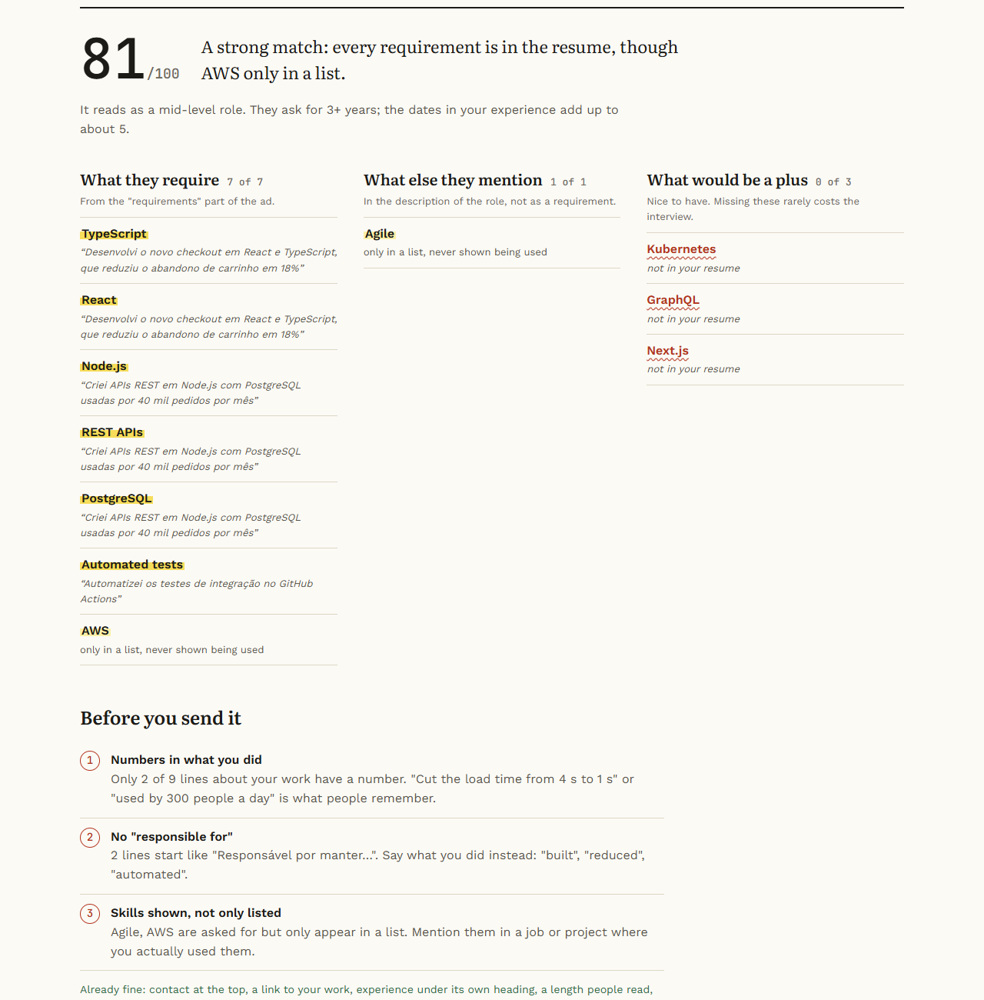
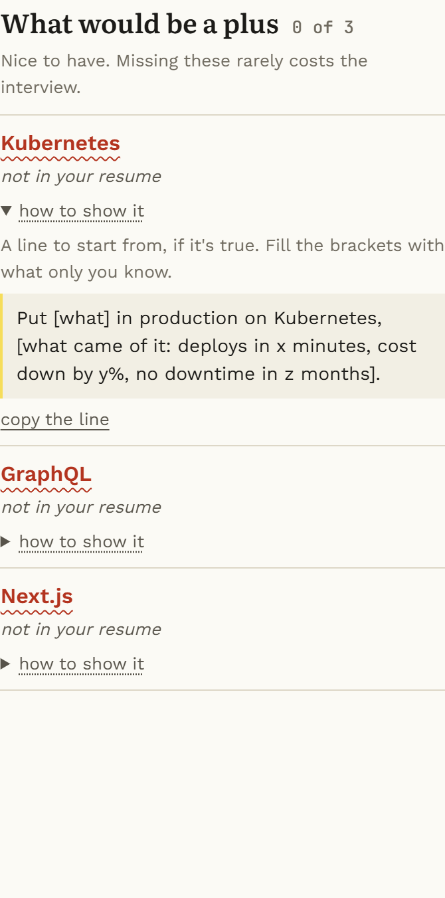
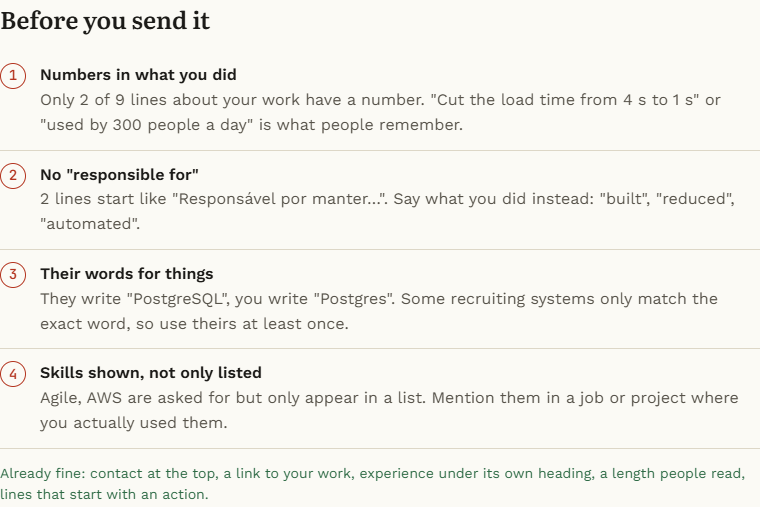
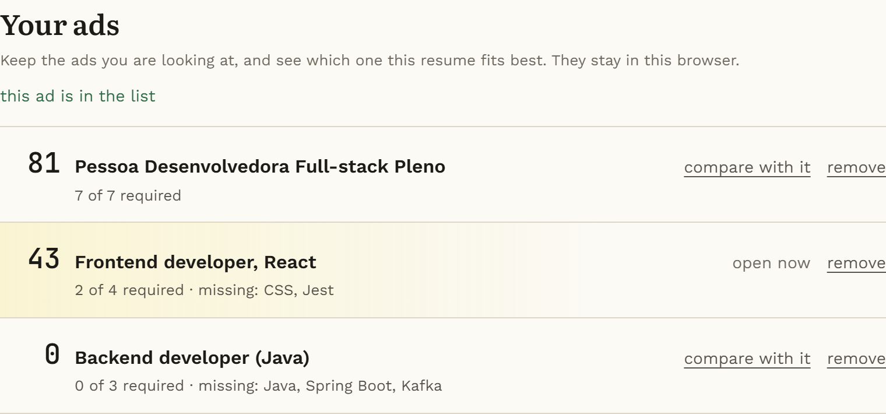
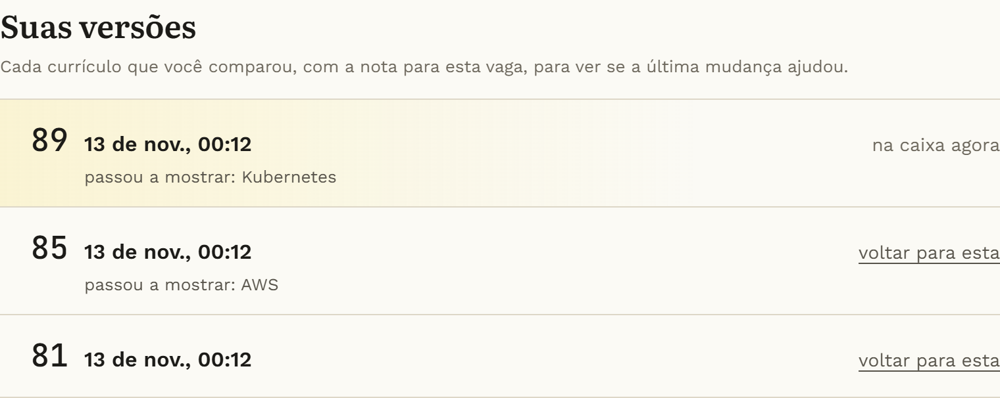
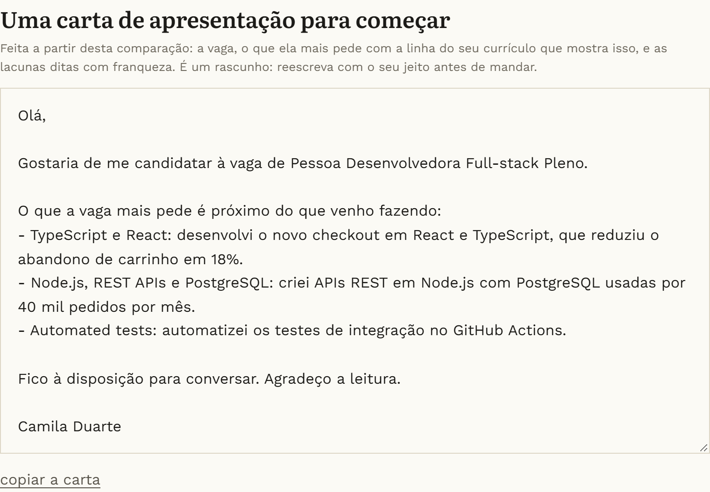
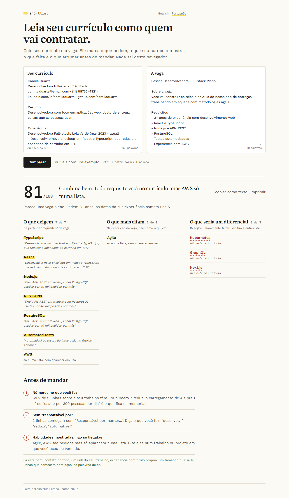
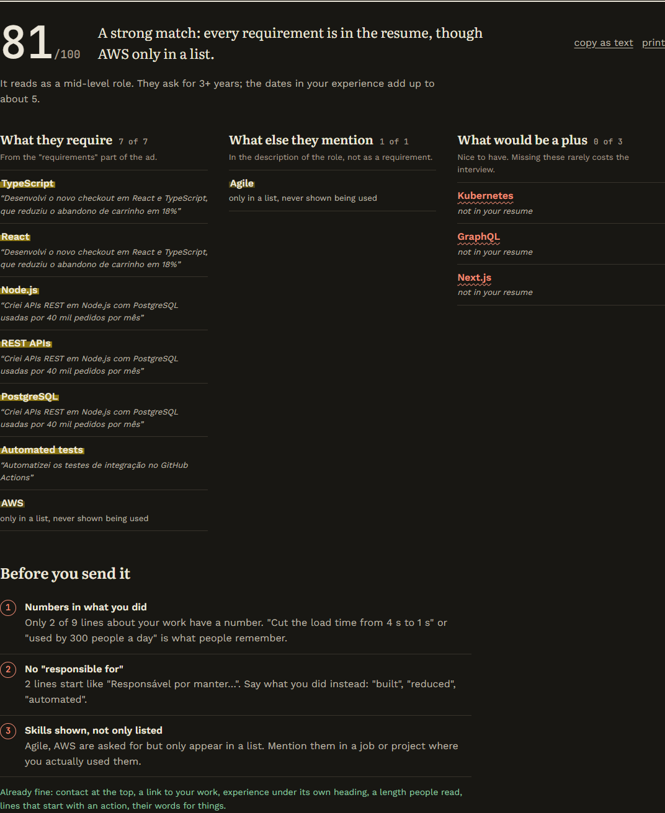

# shortlist

Paste your resume and a job ad, and see how close they are: what the ad asks for, what your resume shows, what's missing, and what to fix before sending it.

**Try it:** [viniciusclemos.github.io/shortlist](https://viniciusclemos.github.io/shortlist/). There's an example button if you just want to see it work.



## How it reads

- **The job ad** is split by its headers, the way ads are actually written in Brazil and abroad: *Requisitos* / *Requirements* is required, *Diferenciais* / *Nice to have* is a plus, *Responsabilidades* / *What you'll do* counts as mentioned. A line like "Docker (desejável)" inside the requirements is still a plus. *Benefícios* is skipped, so "auxílio para curso de inglês" isn't read as "English required". It also picks up "3+ anos de experiência" and the level in the title (júnior, pleno, sênior).
- **The resume** is split into its sections (experience, projects, skills, education...), so it knows *where* each skill shows up. React in a job line that says what you built with it is worth more than React in a list of 30 technologies: a skill that's only listed counts 60%.
- **Experience** is added up from the date ranges ("mar 2023 - atual", "01/2020 – 12/2021"), and two jobs at the same time don't count twice.
- **Skills** come from a dictionary of about 110, each with the ways people write it ("Node.js", "NodeJS", "node"; "testes unitários", "unit tests", "TDD"). Short names that are also plain words ("Go", "Excel", "REST", "C") only count written the technical way, so "I go to" and "excel at" don't turn into skills.

## What it says

A score from 0 to 100 (required counts 3, mentioned 2, a plus 1), a sentence about the match, what's missing, and a few checks on the resume itself: contact at the top, a GitHub or LinkedIn link, lines with numbers in them ("reduced cart abandonment by 18%"), lines that start with what you did instead of "responsible for", skills the ad asks for that only show up in a list, and skills written differently from the ad.

That last one is about the filters many companies put in front of the recruiter: if the ad says "PostgreSQL" and the resume says "Postgres", a person reads it as the same thing, but a filter matching words may not. It only flags real variants of a name (Postgres / PostgreSQL, k8s / Kubernetes, JS / JavaScript), not two related things under one skill like "Scrum" and "agile methods".

For each skill the resume doesn't show, or only lists, there's a folded **"how to show it"** with a line to start from: what, with what, and what came of it, with brackets for what only you know (*"Put [what] in production on Kubernetes, [what came of it: deploys in x minutes...]"*). One shape per kind of skill, in English and Portuguese. It says plainly that it's for things that are true; if you never used it, the honest fix is to leave it out.





**Your ads.** Looking for a job means reading ten ads, not one. Each ad compared can be kept in a list, and the list ranks them against the resume: the score, how many of the required skills it shows, and which ones it doesn't (*"0 of 3 required · missing: Java, Spring Boot, Kafka"*). One click opens any of them as the current ad. The scores are worked out again each time, so improving the resume moves every ad up. The ads stay in the browser, like everything else.



**Your versions.** Every different resume you compare is kept (the last eight), and each one is scored against the ad open now, newest first, with what it started or stopped showing compared to the one before (*"89 · started showing: Kubernetes"*). Shown means used in a job or a project, not just typed in a list. So the question "did that last change help?" has an answer, and an older version is one click away if it didn't.



**A cover letter to start from.** Under the report there's a first draft made from the comparison: the role, taken from the ad's first line; the skills the ad wants most, each with the line of your resume that shows it ("TypeScript and React: built the new checkout in React and TypeScript, which cut cart abandonment by 18%"), with skills proved by the same line told once; and the required ones you don't have, said plainly, because a gap the recruiter finds on their own reads worse than one you named. It's signed with the name at the top of the resume. The letter goes in the language of the ad, not the page's, so an ad in Portuguese gets a letter in Portuguese. It can be edited in place and copied, and the page says what it is: a draft to rewrite so it sounds like you.



## Why no AI (yet)

Everything runs in the browser: the resume never leaves the computer, it's instant, it's free to host, and when it says "Kubernetes is missing" you can see exactly which line of the ad asked for it. An AI step to rewrite the weak lines is planned on top of this, as an option.

## The page

Two sheets side by side, the resume and the ad. The resume can also be picked as a PDF: pdf.js reads it right there in the browser, and it only loads when someone picks a file, so the page stays light. A scanned PDF has no text in it, and it says so instead of failing quietly. A Word file (.docx) works too, without a library: a .docx is a zip, so the page finds `word/document.xml` in it, inflates it with the browser's own `DecompressionStream` and keeps one line per paragraph.

The report reads like a note from someone who read both: what they require, with the line of your resume that shows each one highlighted (or "only in a list"), the missing ones underlined in red, and a numbered list of what to fix before sending. The two texts stay in the browser's storage for the next visit, and nowhere else.

The page comes in English and in Portuguese, picked from the browser's language and switched at the top. The report's sentences live in their own file, apart from the rules, so a translation can't change a score: both languages get the same 81.



A few small things that make it nicer to use more than once: Ctrl+Enter compares from either sheet, the report says when you've changed the text since it was made, "copy as text" gives a plain version to paste in your notes or send to whoever is helping with the resume, and printing gives just the report, on white.



## On a phone, with a keyboard, with a screen reader

- Works down to a 360px screen without anything sliding sideways. The text boxes are 16px so iOS doesn't zoom in when you tap them, and the small links have a finger-sized hit area.
- After comparing, the focus moves to the report, so a screen reader starts at the score.
- If the system is set to reduce motion, the page jumps to the report instead of gliding.
- Checked with axe in light and dark mode, on a phone and on a desktop.

## Running

```bash
npm install
npm run dev     # the page on localhost:5173
npm test        # the engine's tests
npm run build && npm run e2e   # the built page in a real browser, desktop and phone, with axe
```

It's deployed to GitHub Pages by the same Action that runs the tests.
